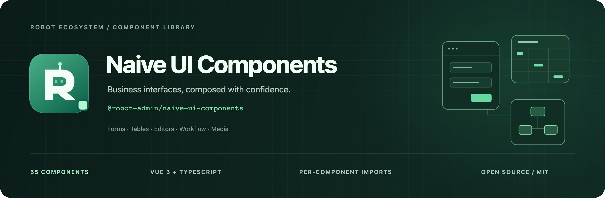

<!-- 封面源文件与导出方式：docs/assets/README.md -->



<div align="center">
  <p><strong>把重复的业务交互，沉淀为可组合的组件。</strong></p>
  <p>Vue 3 · Naive UI · TypeScript · 60 个业务组件</p>
  <p>
    <a href="https://www.npmjs.com/package/@robot-admin/naive-ui-components"></a>
    <a href="./package.json"></a>
    <a href="./package.json"></a>
    <a href="https://github.com/ChenyCHENYU/naive-ui-components/actions/workflows/ci.yml"></a>
    <a href="./LICENSE"></a>
  </p>
  <p>
    <a href="#快速开始">快速开始</a> ·
    <a href="#能力地图">能力地图</a> ·
    <a href="./docs/components.md">组件目录</a> ·
    <a href="https://www.tzagileteam.com/robot/components/preface">在线文档</a> ·
    <a href="https://robotadmin.cn">在线体验</a> ·
    <a href="./README_EN.md">English</a>
  </p>
</div>

## 项目定位

**Naive UI Components** 是从 [Robot Admin](https://github.com/ChenyCHENYU/Robot_Admin) 提炼的 Vue 3 业务组件库，以 `@robot-admin/naive-ui-components` 独立发布。基于 Naive UI，将配置表单、数据表格、编辑器、流程与文件媒体等常见场景统一为 `C_*` 组件及配套组合函数，也可独立接入其他 Vue 3 项目。

| 设计重点 | 当前提供                                                                                               |
| -------- | ------------------------------------------------------------------------------------------------------ |
| 配置驱动 | 表单字段、表格列、操作按钮与弹窗通过类型化配置组合；表单提供 8 种布局                                  |
| 类型贯通 | 字段路径、列定义、事件与实例方法配套类型；提供 `defineFormOptions`、`useCForm`、`useTableQuery` 等助手 |
| 按需消费 | 60 个独立组件入口、自动导入 Resolver、组件样式入口，以及表单／表格的基础样式层级                       |
| 独立接入 | 支持全量注册与局部导入；反馈、文案和全局配置可由宿主提供，表单弹窗可接入结构兼容的 Headless CRUD       |

组件库负责界面与交互；业务接口、身份权限、上传服务和第三方平台配置由应用接入。当前仓库版本 **0.24.3**，版本变化见 [CHANGELOG](./CHANGELOG.md)。

0.24.3 复核了异步校验与编辑会话、字典订阅、列拖拽、媒体与图实例、数据快照及依赖边界，修复已复现的问题并删除死状态与不可达重试分支。审查范围、性能约束和验证证据见[稳定性复核](./docs/stability-review-20261031.md)。

表单与搜索共用 `config.density: 'compact'`：收紧字段、布局和空校验区，实际错误仍自然展开。表单弹窗默认紧凑，页脚按钮 22px；搜索可继承应用密度。紧凑数字输入默认隐藏步进按钮，保留键盘、精度和上下限，也可逐字段开启。按需设置默认值与显式覆盖见[表单密度](./docs/guides/form-density.md)。

业务工作台新增共享字典 Provider、容器搜索、区域密度、远程选择、错误导航及批量结果；纯值工具走 `/data`，组合函数走 `/workflows`。接入见[业务数据与工作台](./docs/guides/data-workflows.md)、[搜索工作流](./docs/guides/search-workflows.md)、[远程选择](./docs/guides/data-picker.md)和[批量结果](./docs/guides/batch-results.md)。

## 能力地图

`C_Table` 保留 Naive UI 原生空态，继承 Provider 的主题、语言与 `componentOptions.DataTable.renderEmpty`。使用 `#empty` 可替换单个表格的空态内容。

| 场景       | 代表组件                                                         | 覆盖能力                                                 |
| ---------- | ---------------------------------------------------------------- | -------------------------------------------------------- |
| 数据录入   | `C_Form` · `C_FormModal` · `C_FormSearch`                        | 动态字段、校验、异步提交、搜索与新增／编辑弹窗           |
| 数据操作   | `C_Table` · `C_ActionBar` · `C_Tree` · `C_Transfer`              | 分页、树形数据、行／单元格编辑、跨页选择、导出与批量操作 |
| 专业编辑   | `C_Editor` · `C_Markdown` · `C_Cron` · `C_FormulaEditor`         | 富文本、Markdown、Cron 预览、公式编辑与本地试算          |
| 流程与计划 | `C_AntV` · `C_WorkFlow` · `C_VtableGantt` · `C_FullCalendar`     | ER／BPMN／UML、审批流程、甘特与日历                      |
| 文件与媒体 | `C_Upload` · `C_FilePreview` · `C_VideoPlayer` · `C_AudioPlayer` | 分片上传、PDF／Word／Excel 预览、音视频播放              |
| 图像与空间 | `C_Signature` · `C_ImageCropper` · `C_QRCode` · `C_Map`          | 签名、裁剪、二维码、OpenStreetMap／高德地图              |
| 工作空间   | `C_Menu` · `C_Tabs` · `C_TagsView` · `C_GlobalSearch`            | 菜单、场景切换、多标签导航、全局搜索                     |
| 通用交互   | `C_Login` · `C_Captcha` · `C_Guide` · `C_PageLoading`            | 登录、人机验证、功能引导、页面切换反馈                   |

查看 [全部 60 个组件与依赖](./docs/components.md)，或在 [Robot Admin](https://robotadmin.cn) 中体验组件场景。Cron 预览只计算时间，公式只进行本地试算；生产人机验证需接入服务端校验，详见[使用指南](./docs/guides/usage.md)。

## 快速开始

### 安装

在已有 Vue 3 项目中安装组件库及必需的 peer 依赖：

```bash
bun add @robot-admin/naive-ui-components
bun add vue@^3.5.3 naive-ui@^2.35.0
```

也可使用项目现有的 npm 或 pnpm。仅在对应场景安装可选 peer：

| 功能                                       | 额外安装                       |
| ------------------------------------------ | ------------------------------ |
| 主入口导入 / `C_Breadcrumb` / `C_TagsView` | `vue-router@^4.6.4` / `^5.3.1` |
| `C_Table` 行／列拖拽                       | `sortablejs@^1.15.7`           |

### 用配置创建一个表单

以下示例可放入 `App.vue`，使用独立组件入口和对应样式，无需全局注册：

```vue
<script setup lang="ts">
  import { ref } from 'vue'
  import {
    C_Form,
    defineFormOptions,
    useCForm,
  } from '@robot-admin/naive-ui-components/C_Form'
  import '@robot-admin/naive-ui-components/C_Form/style.css'

  interface Contact {
    name: string
    email: string
  }

  const result = ref('')
  const { formRef, bindings } = useCForm<Contact>({
    initialValues: { name: '', email: '' },
    options: defineFormOptions<Contact>([
      { type: 'input', prop: 'name', label: '姓名', required: true },
      { type: 'input', prop: 'email', label: '邮箱' },
    ]),
    config: {
      labelPlacement: 'top',
      onSubmit: ({ model }) => {
        result.value = `已通过校验：${model.name}`
      },
    },
  })
</script>

<template>
  <C_Form
    ref="formRef"
    v-bind="bindings"
  />
  <p v-if="result">{{ result }}</p>
</template>
```

表单内置提交、重置与校验流程。实际保存时，将异步请求放入 `config.onSubmit` 并等待完成；`@submit` 用于完成通知。表单布局、验证规则、弹窗与远程表格示例见[使用指南](./docs/guides/usage.md)。

## 按需加载与样式

### 选择导入方式

| 方式                 | 适用场景                       | 样式                               |
| -------------------- | ------------------------------ | ---------------------------------- |
| 子路径导入           | 显式控制每个组件的依赖入口     | 导入 `C_组件名/style.css`          |
| Resolver 自动导入    | 模板直接使用组件，减少手动导入 | 显式设置 `importStyle: true`       |
| 主入口具名导入       | 已有项目使用 Tree-Shaking      | 手动导入所需样式或全量 `style.css` |
| `app.use()` 全量注册 | 统一注册整个组件库             | 导入全量 `style.css`               |

### 自动导入

安装 `unplugin-vue-components` 后，在 Vite 配置中加入 Resolver：

```bash
bun add -d unplugin-vue-components
```

```ts
// vite.config.ts
import { defineConfig } from 'vite'
import vue from '@vitejs/plugin-vue'
import Components from 'unplugin-vue-components/vite'
import { RobotNaiveUiResolver } from '@robot-admin/naive-ui-components/resolver'

export default defineConfig({
  plugins: [
    vue(),
    Components({
      resolvers: [RobotNaiveUiResolver({ importStyle: true })],
    }),
  ],
})
```

Resolver 默认解析到组件子路径；`importStyle` 默认是 `false`，需显式开启自动样式。`true` 与 `'full'` 均加载完整组件样式；`'base'` 为 `C_Form` / `C_Table` 排除内置富文本编辑器样式，其他组件仍使用完整样式。只有不使用内置富文本字段时才选择基础样式。

每个组件样式入口包含其组合组件所需样式。手动导入时可选 `C_Form/base.css`、`C_Table/base.css`；完整样式也提供 `full.css` 别名。重型编辑器、流程、地图和媒体组件建议随业务路由加载。完整策略与全量注册示例见[导入指南](./docs/guides/usage.md#导入方式)。

本轮最小消费构建中，基础表单与展示表格的首屏 JS gzip 分别下降 36.1% 和 34.6%；包含 Vue 与 Naive UI，测量范围及自动体积门禁见[消费体积记录](./docs/performance-0.15.0.md)。

根入口聚合导航组件，运行时也需要 `vue-router`。不使用路由的项目请选择组件子路径，无需因此补装无关可选 peer。

## 文档导航

| 文档                                                     | 内容                                                             |
| -------------------------------------------------------- | ---------------------------------------------------------------- |
| [架构与隔离](./docs/architecture.md)                     | 依赖边界、实例所有权与独立 Element Plus 演进路线                 |
| [组件目录](./docs/components.md)                         | 60 个组件、外部依赖与各组件的使用边界                            |
| [使用指南](./docs/guides/usage.md)                       | 导入、表单表格、Cron／公式、地图、引导、人机验证、登录与页面加载 |
| [密度与多表工作台](./docs/guides/table-density.md)       | 表单/搜索/表格统一密度、编辑模式、分屏与树能力                   |
| [大列表与异步任务](./docs/guides/runtime-performance.md) | 自动窗口化、聊天滚动、搜索索引、字幕与图片任务                   |
| [瀑布流长列表](./docs/guides/waterfall.md)               | 自动窗口化、嵌套滚动、变高卡片与键盘导航                         |
| [兼容 API 迁移](./docs/guides/api-migration.md)          | 标准模型、应用渲染器与只读迁移检查                               |
| [真实场景覆盖](./docs/wl-ui-produce-coverage.md)         | wl-ui-produce 对照、可组合能力与需要适配的边界                   |
| [开发与构建](./docs/engineering.md)                      | 工程结构、六阶段构建、组件扩展、校验与发布流程                   |
| [品牌资源](./docs/assets/README.md)                      | Robot 系列 Logo、可编辑 SVG 与高清 PNG 封面                      |
| [变更记录](./CHANGELOG.md)                               | 版本更新与兼容变化                                               |
| [安全策略](./SECURITY.md)                                | 漏洞报告与维护约定                                               |

本轮依赖审计的两项上游告警见 [2026-10-18 扫描记录](./docs/security-scan-2026-10-18.md)；[2026-10-06 记录](./docs/security-scan-2026-10-06.md)保留为历史档案。当前依赖状态以实际运行 `bun run check:audit` 的结果为准。

## 本地开发

维护本仓库需要 **Node.js ≥20.19.0**、固定的 **Bun 1.4.2**；CI 按 `.node-version` 与冻结锁文件安装，并校验实际依赖覆盖。消费者的 Bun 最低版本仍为 1.3.14。

```bash
git clone https://github.com/ChenyCHENYU/naive-ui-components.git
cd naive-ui-components
bun install --frozen-lockfile
bun run dev
```

`dev` 监听组件库与共享 SCSS 的构建变化。交互演示由 Robot Admin 消费组件库提供。

```bash
bun run verify       # Lint、类型、逻辑与组件测试、导出、构建与使用侧类型
bun run check:audit  # 单独运行依赖安全审计，CI 在 verify 前执行
```

各项检查与发布步骤见[开发与构建](./docs/engineering.md)，CI 定义见 [ci.yml](./.github/workflows/ci.yml)。

## Robot 生态

| 项目                                                                        | 职责                                                |
| --------------------------------------------------------------------------- | --------------------------------------------------- |
| **Naive UI Components**                                                     | 可独立消费的 Vue 3 业务组件与组合函数               |
| [Robot Admin](https://github.com/ChenyCHENYU/Robot_Admin)                   | PC Web 工程模板、业务页面与组件交互演示             |
| [robot-admin-packages](https://github.com/ChenyCHENYU/robot-admin-packages) | 请求、验证、主题、布局、指令、文件工具与 Git 工程包 |
| [Robot Cloud](https://github.com/ChenyCHENYU/Robot_Cloud)                   | 认证、公司上下文、系统管理与权限治理后端            |

## 许可证

[MIT License](./LICENSE) · Made by [CHENY](https://github.com/ChenyCHENYU)

## 内容列宽与状态颜色（0.24）

`C_Table` 未声明 `width` 的业务列默认按表头和显示文字测宽，均匀抽样最多 100 条已加载数据，默认 80–360px。`minWidth/maxWidth` 可调整边界；显式列宽、原生百分比宽度、列设置后的宽度和 `display.columnWidth` 优先。`autoWidth: false` 恢复原统一默认 180px。横向虚拟化同样使用数值测宽，不依赖浏览器扫描所有行；长内容默认省略并提供 tooltip。

```ts
const columns = [
  { type: 'index' },
  { key: 'customer', title: '客户', maxWidth: 280 },
  { key: 'status', title: '状态', dictionary: 'order-status', status: true },
  {
    key: 'planStatus',
    title: '计划状态',
    status: {
      S1B: { label: '待复核', color: 'danger' },
      S1C: { label: '已完成', color: 'success' },
      special: { label: '特殊处理', color: '#8b5cf6' },
    },
  },
]
```

状态列复用 Naive UI 标签和主题。支持 `success/warning/danger/info/neutral`，也支持 Naive 的 `error/default/primary` 和 CSS 颜色。未知代码保持中性；`0/false` 是有效值，空值保留空态。显式 render 优先；formatter/字典文字会用于默认颜色判断和测宽。状态配置只改变展示，不会改写数据、排序、筛选或导出。

测宽不额外挂载或执行 render；图标、进度条和复杂自定义内容请显式指定 width。数据与字典更新会触发新的有界测量，配置和缓存只属于当前组件实例。此版本将未声明宽度的业务列由自然布局改为有界内容宽度；既有显式布局及原生 table-layout 覆盖仍保留。

表头默认完整展示，不随单元格 ellipsis 配置省略。所有业务列的最小宽度计入完整标题及排序/筛选控件；初始布局、显式窄列宽、恢复列设置与拖拽缩列均受此下限保护。360px 仅限制数据内容测宽；标题更长时允许超过该值，并使用表格内部横向滚动。复杂自定义标题请配置 minWidth。

紧凑表单与搜索的纵向间距收紧至 4px，空反馈区 2px，校验按内容自然撑高。表单弹窗同步收紧并支持内部滚动；移除逐字段排队入场和布局尺寸动画。详情的左右同排展示见 Robot_Admin 产销模块。
