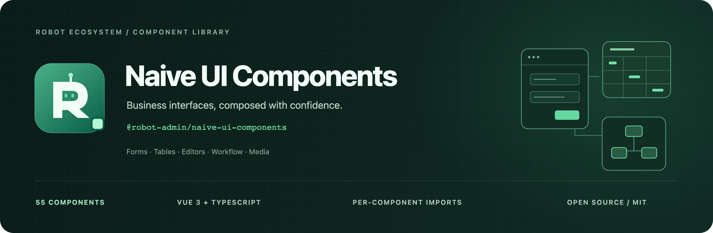

<!-- 封面源文件与导出方式：docs/assets/README.md -->



<div align="center">
  <p><strong>把重复的业务交互，沉淀为可组合的组件。</strong></p>
  <p>Vue 3 · Naive UI · TypeScript · 63 个业务组件</p>
  <p>
    <a href="https://www.npmjs.com/package/@robot-admin/naive-ui-components"></a>
    <a href="./package.json"></a>
    <a href="./docs/engineering.md#typescript-构建与消费"></a>
    <a href="https://github.com/ChenyCHENYU/naive-ui-components/actions/workflows/ci.yml"></a>
    <a href="./LICENSE"></a>
  </p>
  <p>
    <a href="#快速开始">快速开始</a> ·
    <a href="#能力地图">能力地图</a> ·
    <a href="./docs/components.md">组件目录</a> ·
    <a href="https://www.tzagileteam.com/robot/components/preface">在线文档</a> ·
    <a href="https://robotadmin.cn">在线体验</a> ·
    <a href="./README_EN.md">English</a>
  </p>
</div>

## 项目定位

**Naive UI Components** 是从 [Robot Admin](https://github.com/ChenyCHENYU/Robot_Admin) 提炼的 Vue 3 业务组件库，以 `@robot-admin/naive-ui-components` 独立发布。基于 Naive UI，将配置表单、数据表格、编辑器、流程与文件媒体等常见场景统一为 `C_*` 组件及配套组合函数，也可独立接入其他 Vue 3 项目。

| 设计重点 | 当前提供                                                                                               |
| -------- | ------------------------------------------------------------------------------------------------------ |
| 配置驱动 | 表单字段、表格列、操作按钮与弹窗通过类型化配置组合；表单提供 8 种布局                                  |
| 类型贯通 | 字段路径、列定义、事件与实例方法配套类型；提供 `defineFormOptions`、`useCForm`、`useTableQuery` 等助手 |
| 按需消费 | 63 个独立组件入口、自动导入 Resolver、组件样式入口，以及表单／表格的基础样式层级                       |
| 独立接入 | 支持全量注册与局部导入；反馈、文案和全局配置可由宿主提供，表单弹窗可接入结构兼容的 Headless CRUD       |

组件库负责界面与交互。业务接口、身份权限、上传服务和第三方平台配置由应用接入。当前仓库版本 **0.40.5**，版本变化见 [CHANGELOG](./CHANGELOG.md)。

接入时直接使用组件 props、业务数据和公开类型；复杂表单、查询与弹窗再使用对应组合函数。已有项目见 [0.40.4 接入收敛说明](./docs/guides/api-migration.md#0404-接入收敛)，可逐页简化配置，现有兼容入口继续保留。

## 能力地图

| 场景       | 代表组件                                                         | 覆盖能力                                                           |
| ---------- | ---------------------------------------------------------------- | ------------------------------------------------------------------ |
| 数据录入   | `C_Form` · `C_FormModal` · `C_FormSearch`                        | 动态字段、校验、异步提交、搜索与新增／编辑弹窗                     |
| 数据操作   | `C_Table` · `C_ActionBar` · `C_Tree` · `C_Transfer`              | 分页、树形数据、常显录入、行／单元格编辑、跨页选择、导出与批量操作 |
| 搜索与选择 | `C_Select` · `C_AutoComplete` · `C_DataPicker` · `C_UserPicker`  | 远程选项、文本建议、多列表格选择与组织选人                         |
| 结构与卡片 | `C_OrgChart` · `C_WaterFall`                                     | 汇报关系、响应式卡片布局、长列表窗口化与业务字段推导               |
| 专业编辑   | `C_Editor` · `C_Markdown` · `C_Cron` · `C_FormulaEditor`         | 富文本、Markdown、Cron 预览、公式编辑与本地试算                    |
| 流程与计划 | `C_AntV` · `C_WorkFlow` · `C_VtableGantt` · `C_FullCalendar`     | ER／BPMN／UML、审批流程、甘特与日历                                |
| 文件与媒体 | `C_Upload` · `C_FilePreview` · `C_VideoPlayer` · `C_AudioPlayer` | 分片上传、PDF／Word／Excel 预览、音视频播放                        |
| 图像与空间 | `C_Signature` · `C_ImageCropper` · `C_QRCode` · `C_Map`          | 签名、裁剪、二维码、OpenStreetMap／高德地图                        |
| 工作空间   | `C_Menu` · `C_Tabs` · `C_TagsView` · `C_GlobalSearch`            | 菜单、场景切换、多标签导航、全局搜索                               |
| 通用交互   | `C_Login` · `C_Captcha` · `C_Guide` · `C_PageLoading`            | 登录、人机验证、功能引导、页面切换反馈                             |

查看 [全部 63 个组件与依赖](./docs/components.md)，或在 [Robot Admin](https://robotadmin.cn) 中体验组件场景。Cron 预览只计算时间，公式只进行本地试算；生产人机验证需接入服务端校验，详见[使用指南](./docs/guides/usage.md)。

### 按任务选择组件

| 需要完成的任务           | 推荐入口与用法                                                                                                                                                         |
| ------------------------ | ---------------------------------------------------------------------------------------------------------------------------------------------------------------------- |
| 筛选、编辑与批量操作     | 组合 `C_FormSearch`、`C_FormModal` 与 `C_ActionBar`，共享表单字段和紧凑密度；见[工作台组合](./docs/guides/data-workflows.md)                                           |
| 选项、文本建议或实体选择 | `C_Select` 选值，`C_AutoComplete` 补全文本，`C_DataPicker` 展示多列实体；远程字段直接配置 `source`，见[搜索与选择](./docs/guides/search-workflows.md)                  |
| 目录、汇报关系或人员选择 | 分别使用 `C_Tree`、`C_OrgChart`、`C_UserPicker`；见[组织场景](./docs/guides/tree-org-examples.md)与[人员选择](./docs/guides/user-picker.md)                            |
| 表格展示与录入           | `C_Table` 默认带序号和分页；选择列即可启用多选，`config.edit` 切换编辑模式；见[编辑指南](./docs/guides/table-editing.md)与[列宽及密度](./docs/guides/table-density.md) |

表单和搜索可搭配 `C_Table` 或其他表格，各自保留原生列与分页契约。流程、上传、地图等组件提供界面和接入点，真实审批执行、文件服务及平台权限仍由应用负责。

## 快速开始

### 安装

在已有 Vue 3 项目中安装组件库及必需的 peer 依赖：

```bash
bun add @robot-admin/naive-ui-components
bun add vue@^3.5.3 naive-ui@^2.35.0
```

最低组合覆盖浏览器打包、类型与 CJS SSR；原生 Node ESM SSR 的已验证配置使用 Naive UI 2.45.3。旧版分发格式的边界见[消费环境矩阵](./docs/engineering.md#消费环境矩阵)。

也可使用项目现有的 npm 或 pnpm。仅在对应场景安装可选 peer：

| 功能                                       | 额外安装                       |
| ------------------------------------------ | ------------------------------ |
| 主入口导入 / `C_Breadcrumb` / `C_TagsView` | `vue-router@^4.6.4` / `^5.3.1` |
| `C_Table` 行／列拖拽                       | `sortablejs@^1.15.7`           |

### 用配置创建一个表单

以下示例可放入 `App.vue`，使用独立组件入口和对应样式，无需全局注册：

```vue
<script setup lang="ts">
  import { ref } from 'vue'
  import {
    C_Form,
    defineFormOptions,
    useCForm,
  } from '@robot-admin/naive-ui-components/C_Form'
  import '@robot-admin/naive-ui-components/C_Form/style.css'

  interface Contact {
    name: string
    email: string
  }

  const result = ref('')
  const { formRef, bindings } = useCForm<Contact>({
    initialValues: { name: '', email: '' },
    options: defineFormOptions<Contact>([
      { type: 'input', prop: 'name', label: '姓名', required: true },
      { type: 'input', prop: 'email', label: '邮箱' },
    ]),
    config: {
      labelPlacement: 'top',
      onSubmit: ({ model }) => {
        result.value = `已通过校验：${model.name}`
      },
    },
  })
</script>

<template>
  <C_Form
    ref="formRef"
    v-bind="bindings"
  />
  <p v-if="result">{{ result }}</p>
</template>
```

表单内置提交、重置与校验流程。实际保存时，将异步请求放入 `config.onSubmit` 并等待完成；`@submit` 用于完成通知。表单布局、验证规则、弹窗与远程表格示例见[使用指南](./docs/guides/usage.md)。

### 直接使用公开 Props

简单组件直接写 props 即可；需要抽出配置时，用组件公开的类型检查字段，无需重复声明接口或增加配置工厂：

```vue
<script setup lang="ts">
  import {
    C_Progress,
    type ProgressProps,
  } from '@robot-admin/naive-ui-components/C_Progress'
  import '@robot-admin/naive-ui-components/C_Progress/style.css'

  const progress = {
    percentage: 62.5,
    isAnimation: true,
  } satisfies ProgressProps
</script>

<template>
  <C_Progress v-bind="progress" />
</template>
```

`BarcodeProps`、`CascadeProps`、`StepsProps`、`CodeProps`、`EditorProps` 和 `MarkdownProps` 同样可从对应组件子路径导入，字段与组件实际 props 共用声明。

### 瀑布流自动推导业务字段

`items` 提供 `id`、`src`、`width`、`height`，其余业务字段自动传递到插槽和事件。无需转换成基础 `WaterFallItem[]`：

```vue
<script setup lang="ts">
  import { C_WaterFall } from '@robot-admin/naive-ui-components/C_WaterFall'
  import '@robot-admin/naive-ui-components/C_WaterFall/style.css'

  const products = [
    {
      id: 1,
      src: '/images/product.jpg',
      width: 640,
      height: 480,
      productCode: 'A-01',
      price: 125.5,
    },
  ]
</script>

<template>
  <C_WaterFall :items="products">
    <template #item="{ item, width, height }">
      
      <p>{{ item.productCode }} · {{ item.price.toFixed(2) }}</p>
    </template>
  </C_WaterFall>
</template>
```

图片路径替换为应用自己的资源。插槽和事件中的条目只读，嵌套 `ref` 保持 Vue 解包语义；编辑时更新应用持有的源数据。长列表、变高卡片与滚动容器配置见[瀑布流指南](./docs/guides/waterfall.md)。

### 表格偏好按账号隔离

应用启动时注册一次。`session` 是项目已有的响应式身份状态，未登录或身份尚未就绪时为 `undefined`：

```ts
import { TABLE_GLOBAL_CONFIG_KEY } from '@robot-admin/naive-ui-components/config'

app.provide(TABLE_GLOBAL_CONFIG_KEY, {
  defaults: { density: 'compact' },
  get persistPrefix() {
    const scope = session.value
    return scope
      ? JSON.stringify([scope.tenantId, scope.companyId, scope.userId])
      : undefined
  },
})
```

页面只配置稳定表 ID，如 `config: { persistKey: 'shipping' }`。全局紧凑默认同步表头、普通行、操作列与编辑区；区域 `C_Density` 或单表配置可覆盖。组件分别保存各范围的列显隐、顺序和宽度，不改写业务列定义。`/config` 是轻量入口，与 `/C_Table` 导出同一个配置键。

启动时就声明该 getter；切换账号只更新响应式身份值，不删除字段。显式 `persistPrefix` 为 `undefined`、空串或空白时不读取、写入偏好，也不回退旧缓存。未配置 `persistPrefix` 的项目保留旧键；没有 `persistKey` 的表格仅保留临时设置，并在范围变化时清空。详见[表格偏好与作用域](./docs/guides/table-density.md#表格偏好与作用域)。

## 按需加载与样式

### 选择导入方式

| 方式                 | 适用场景                       | 样式                               |
| -------------------- | ------------------------------ | ---------------------------------- |
| 子路径导入           | 显式控制每个组件的依赖入口     | 导入 `C_组件名/style.css`          |
| Resolver 自动导入    | 模板直接使用组件，减少手动导入 | 显式设置 `importStyle: true`       |
| 主入口具名导入       | 已有项目使用 Tree-Shaking      | 手动导入所需样式或全量 `style.css` |
| `app.use()` 全量注册 | 统一注册整个组件库             | 导入全量 `style.css`               |

### 自动导入

安装 `unplugin-vue-components` 后，在 Vite 配置中加入 Resolver：

```bash
bun add -d unplugin-vue-components
```

```ts
// vite.config.ts
import { defineConfig } from 'vite'
import vue from '@vitejs/plugin-vue'
import Components from 'unplugin-vue-components/vite'
import { RobotNaiveUiResolver } from '@robot-admin/naive-ui-components/resolver'

export default defineConfig({
  plugins: [
    vue(),
    Components({
      resolvers: [RobotNaiveUiResolver({ importStyle: true })],
    }),
  ],
})
```

Resolver 默认解析到组件子路径；`importStyle` 默认是 `false`，需显式开启自动样式。`true` 与 `'full'` 均加载完整组件样式；`'base'` 为 `C_Form` / `C_Table` 排除内置富文本编辑器样式，其他组件仍使用完整样式。只有不使用内置富文本字段时才选择基础样式。

组件样式入口会加载组合组件及共享设计变量，无需额外导入。手动导入时可选 `C_Form/base.css`、`C_Table/base.css`；完整样式也提供 `full.css` 别名。重型编辑器、流程、地图和媒体组件建议随业务路由加载。完整策略与全量注册示例见[导入指南](./docs/guides/usage.md#导入方式)。

仓库按独立入口构建最小消费场景，校验首屏 JS gzip、重型依赖边界和首次打开增量；数据包含 Vue 与 Naive UI，不能相加作为整站体积，也不替代业务页面的交互测量。检查范围见[开发与构建](./docs/engineering.md#开发)；[0.15.0 体积记录](./docs/performance-0.15.0.md)仅保留为历史对照。

根入口聚合导航组件，运行时也需要 `vue-router`。不使用路由的项目请选择组件子路径，无需因此补装无关可选 peer。

## 文档导航

| 文档                                                            | 内容                                                             |
| --------------------------------------------------------------- | ---------------------------------------------------------------- |
| [架构与隔离](./docs/architecture.md)                            | 依赖边界、实例所有权与独立 Element Plus 演进路线                 |
| [组件目录](./docs/components.md)                                | 63 个组件、外部依赖与各组件的使用边界                            |
| [使用指南](./docs/guides/usage.md)                              | 导入、表单表格、Cron／公式、地图、引导、人机验证、登录与页面加载 |
| [密度与多表工作台](./docs/guides/table-density.md)              | 表单/搜索/表格统一密度、编辑模式、分屏与树能力                   |
| [主题与视觉标准](./docs/guides/theme.md)                        | 统一色彩、明暗主题、尺寸层级与局部覆盖，不增加 Provider          |
| [大列表与异步任务](./docs/guides/runtime-performance.md)        | 自动窗口化、聊天滚动、搜索索引、字幕与图片任务                   |
| [瀑布流长列表](./docs/guides/waterfall.md)                      | 自动窗口化、嵌套滚动、变高卡片与键盘导航                         |
| [兼容 API 迁移](./docs/guides/api-migration.md)                 | 0.40.4 接入收敛、标准模型、应用渲染器与只读迁移检查              |
| [真实场景覆盖](./docs/wl-ui-produce-coverage.md)                | wl-ui-produce 对照、可组合能力与需要适配的边界                   |
| [0.40.4 组件审计记录](./docs/component-audit-closure-0.40.4.md) | 该版本的逐组件修复、类型收敛、兼容边界与正式产物验证             |
| [开发与构建](./docs/engineering.md)                             | 工程结构、六阶段构建、组件扩展、校验与发布流程                   |
| [品牌资源](./docs/assets/README.md)                             | Robot 系列 Logo、可编辑 SVG 与高清 PNG 封面                      |
| [变更记录](./CHANGELOG.md)                                      | 版本更新与兼容变化                                               |
| [安全策略](./SECURITY.md)                                       | 漏洞报告与维护约定                                               |

依赖安全以实际锁文件和当次审计为准：`bun run check:audit` 保留原始发现，并核验精确的本地缓解或不受影响证据；`check:audit:raw` 提供原始报告。仓库 overrides 与开发补丁不会自动传给使用侧，应用需审计自己的锁文件。历史扫描不代表当前结果，已打包运行时与消费依赖的边界见[安全策略](./SECURITY.md)。

## 本地开发

维护本仓库需要 **Node.js ≥20.19.0**、固定的 **Bun 1.4.2**；CI 按 `.node-version` 与冻结锁文件安装，并校验实际依赖覆盖。消费者的 Bun 最低版本仍为 1.3.14。

源码检查与构建使用锁定的 **TypeScript 5.9.3**。CI 另用 **TypeScript 5.8.3** 验证构建后声明的消费兼容性，不代表以 5.8 构建本仓库源码；详见[TypeScript 构建与消费](./docs/engineering.md#typescript-构建与消费)。

```bash
git clone https://github.com/ChenyCHENYU/naive-ui-components.git
cd naive-ui-components
bun install --frozen-lockfile
bun run dev
```

`dev` 监听组件库与共享 SCSS 的构建变化。交互演示由 Robot Admin 消费组件库提供。

```bash
bun run verify       # Lint、类型、逻辑与组件测试、导出、构建与使用侧类型
bun run check:audit  # 单独运行依赖安全审计，CI 在 verify 前执行
```

各项检查与发布步骤见[开发与构建](./docs/engineering.md)，CI 定义见 [ci.yml](./.github/workflows/ci.yml)。

## Robot 生态

| 项目                                                                        | 职责                                                |
| --------------------------------------------------------------------------- | --------------------------------------------------- |
| **Naive UI Components**                                                     | 可独立消费的 Vue 3 业务组件与组合函数               |
| [Robot Admin](https://github.com/ChenyCHENYU/Robot_Admin)                   | PC Web 工程模板、业务页面与组件交互演示             |
| [robot-admin-packages](https://github.com/ChenyCHENYU/robot-admin-packages) | 请求、验证、主题、布局、指令、文件工具与 Git 工程包 |
| [Robot Cloud](https://github.com/ChenyCHENYU/Robot_Cloud)                   | 认证、公司上下文、系统管理与权限治理后端            |

## 许可证

[MIT License](./LICENSE) · Made by [CHENY](https://github.com/ChenyCHENYU)
