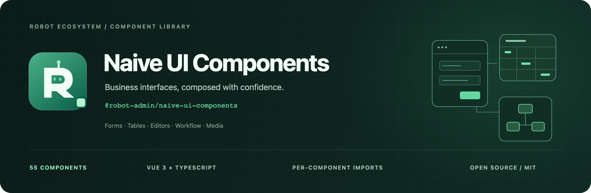

<!-- Banner source and export instructions: docs/assets/README.md -->



<div align="center">
  <p><strong>Turn recurring business interactions into composable components.</strong></p>
  <p>Vue 3 · Naive UI · TypeScript · 63 business components</p>
  <p>
    <a href="https://www.npmjs.com/package/@robot-admin/naive-ui-components"></a>
    <a href="./package.json"></a>
    <a href="./docs/engineering.en.md#typescript-build-and-consumption"></a>
    <a href="https://github.com/ChenyCHENYU/naive-ui-components/actions/workflows/ci.yml"></a>
    <a href="./LICENSE"></a>
  </p>
  <p>
    <a href="#quick-start">Quick start</a> ·
    <a href="#capability-map">Capabilities</a> ·
    <a href="./docs/components.en.md">Component catalog</a> ·
    <a href="https://www.tzagileteam.com/robot/components/preface">Online docs</a> ·
    <a href="https://robotadmin.cn">Live demo</a> ·
    <a href="./README.md">简体中文</a>
  </p>
</div>

## Overview

**Naive UI Components** is a Vue 3 business component library extracted from [Robot Admin](https://github.com/ChenyCHENYU/Robot_Admin), published independently as `@robot-admin/naive-ui-components`. Built on Naive UI, it provides `C_*` components and composables for forms, tables, editors, workflows, files and media. It can also be used in other Vue 3 applications.

| Design focus            | Available today                                                                                                                                              |
| ----------------------- | ------------------------------------------------------------------------------------------------------------------------------------------------------------ |
| Configuration           | Typed configuration for fields, columns, actions and dialogs; 8 form layouts                                                                                 |
| Connected types         | Field paths, columns, events and instance methods, with helpers such as `defineFormOptions`, `useCForm` and `useTableQuery`                                  |
| Selective loading       | 63 component entries, an auto-import resolver, component CSS and base styles for forms and tables                                                            |
| Application integration | Global registration or local imports; injectable feedback, locale and defaults; form dialogs compatible with structurally matching headless CRUD controllers |

The library handles UI and interaction. Applications supply business APIs, authentication, authorization, upload services and platform configuration. The current repository version is **0.40.5**. See the [changelog](./CHANGELOG.md) for release details.

Start with component props, business data and public types. Use composables when coordinating forms, queries and dialogs. Existing projects can simplify one page at a time using the [0.40.4 adoption notes](./docs/guides/api-migration.md#0404-接入收敛) (Chinese); existing compatibility APIs remain available.

## Capability map

| Scenario              | Representative components                                        | Capabilities                                                                                            |
| --------------------- | ---------------------------------------------------------------- | ------------------------------------------------------------------------------------------------------- |
| Data entry            | `C_Form` · `C_FormModal` · `C_FormSearch`                        | Dynamic fields, validation, async submission, search and create/edit dialogs                            |
| Data operations       | `C_Table` · `C_ActionBar` · `C_Tree` · `C_Transfer`              | Pagination, trees, inline/row/cell editing, cross-page selection, exports and batch actions             |
| Search and selection  | `C_Select` · `C_AutoComplete` · `C_DataPicker` · `C_UserPicker`  | Remote options, text suggestions, multi-column entity selection and organization-based people selection |
| Structures and cards  | `C_OrgChart` · `C_WaterFall`                                     | Reporting relationships, responsive cards, list windowing and inferred business fields                  |
| Editing               | `C_Editor` · `C_Markdown` · `C_Cron` · `C_FormulaEditor`         | Rich text, Markdown, Cron previews and local formula evaluation                                         |
| Workflow and planning | `C_AntV` · `C_WorkFlow` · `C_VtableGantt` · `C_FullCalendar`     | ER/BPMN/UML, approval flows, Gantt charts and calendars                                                 |
| Files and media       | `C_Upload` · `C_FilePreview` · `C_VideoPlayer` · `C_AudioPlayer` | Chunked uploads, PDF/Word/Excel previews and audio/video playback                                       |
| Images and maps       | `C_Signature` · `C_ImageCropper` · `C_QRCode` · `C_Map`          | Signatures, cropping, QR codes, OpenStreetMap and AMap                                                  |
| Workspace             | `C_Menu` · `C_Tabs` · `C_TagsView` · `C_GlobalSearch`            | Menus, view switching, tab navigation and global search                                                 |
| Common interactions   | `C_Login` · `C_Captcha` · `C_Guide` · `C_PageLoading`            | Login UI, human verification, onboarding and navigation feedback                                        |

Browse [all 63 components and dependencies](./docs/components.en.md), or explore scenarios in [Robot Admin](https://robotadmin.cn). Cron previews calculate times only; formulas run locally. Production human verification requires server validation. See the [usage guide](./docs/guides/usage.en.md).

### Choose by task

The focused guides below are in Chinese.

| Task                                                         | Recommended entry and usage                                                                                                                                                                                                                              |
| ------------------------------------------------------------ | -------------------------------------------------------------------------------------------------------------------------------------------------------------------------------------------------------------------------------------------------------- |
| Filter, edit and run batch actions                           | Compose `C_FormSearch`, `C_FormModal` and `C_ActionBar`, sharing field definitions and compact density; see [workspace composition](./docs/guides/data-workflows.md)                                                                                     |
| Select values, suggest text or choose entities               | Use `C_Select`, `C_AutoComplete` or `C_DataPicker` respectively; remote fields accept `source` directly. See [search and selection](./docs/guides/search-workflows.md)                                                                                   |
| Browse a hierarchy, display reporting lines or choose people | Use `C_Tree`, `C_OrgChart` or `C_UserPicker`; see [organization examples](./docs/guides/tree-org-examples.md) and [person selection](./docs/guides/user-picker.md)                                                                                       |
| Display and edit tabular data                                | `C_Table` includes row numbers and pagination by default; a selection column enables selection, and `config.edit` selects the editing mode. See [table editing](./docs/guides/table-editing.md) and [widths and density](./docs/guides/table-density.md) |

Forms and search can accompany `C_Table` or another grid, retaining each grid's native column and pagination contracts. Workflow, upload and map components provide UI and integration points; applications own approval execution, file services and platform authorization.

## Quick start

### Install

Add the library and required peer dependencies to an existing Vue 3 application:

```bash
bun add @robot-admin/naive-ui-components
bun add vue@^3.5.3 naive-ui@^2.35.0
```

The minimum peer profile covers browser bundling, types and CJS SSR. The verified native Node ESM SSR configuration uses Naive UI 2.45.3. See the [consumer environment matrix](./docs/engineering.en.md#consumer-environment-matrix).

You can also use your project's npm or pnpm setup. Install optional peers only for the features that need them:

| Feature                                      | Additional dependency          |
| -------------------------------------------- | ------------------------------ |
| Root imports / `C_Breadcrumb` / `C_TagsView` | `vue-router@^4.6.4` / `^5.3.1` |
| `C_Table` row/column dragging                | `sortablejs@^1.15.7`           |

### Build a form from configuration

Place this example in `App.vue`. It uses a component subpath and its CSS entry, with no global registration required:

```vue
<script setup lang="ts">
  import { ref } from 'vue'
  import {
    C_Form,
    defineFormOptions,
    useCForm,
  } from '@robot-admin/naive-ui-components/C_Form'
  import '@robot-admin/naive-ui-components/C_Form/style.css'

  interface Contact {
    name: string
    email: string
  }

  const result = ref('')
  const { formRef, bindings } = useCForm<Contact>({
    initialValues: { name: '', email: '' },
    options: defineFormOptions<Contact>([
      { type: 'input', prop: 'name', label: 'Name', required: true },
      { type: 'input', prop: 'email', label: 'Email' },
    ]),
    config: {
      labelPlacement: 'top',
      onSubmit: ({ model }) => {
        result.value = `Validated: ${model.name}`
      },
    },
  })
</script>

<template>
  <C_Form
    ref="formRef"
    v-bind="bindings"
  />
  <p v-if="result">{{ result }}</p>
</template>
```

The form includes submission, reset and validation. For persistence, await your async request inside `config.onSubmit`; use `@submit` for completion notifications. See the [usage guide](./docs/guides/usage.en.md) for layouts, validation rules, dialogs and remote tables.

### Use public Props directly

For simple components, bind props directly. When extracting configuration, use the component's public type to check fields without duplicating an interface or adding a configuration factory:

```vue
<script setup lang="ts">
  import {
    C_Progress,
    type ProgressProps,
  } from '@robot-admin/naive-ui-components/C_Progress'
  import '@robot-admin/naive-ui-components/C_Progress/style.css'

  const progress = {
    percentage: 62.5,
    isAnimation: true,
  } satisfies ProgressProps
</script>

<template>
  <C_Progress v-bind="progress" />
</template>
```

`BarcodeProps`, `CascadeProps`, `StepsProps`, `CodeProps`, `EditorProps` and `MarkdownProps` are also available from their component subpaths. They share declarations with the actual component props.

### Infer waterfall business fields

Provide `id`, `src`, `width` and `height` in `items`. Additional business fields flow into slots and events automatically, without converting your data to a base `WaterFallItem[]`:

```vue
<script setup lang="ts">
  import { C_WaterFall } from '@robot-admin/naive-ui-components/C_WaterFall'
  import '@robot-admin/naive-ui-components/C_WaterFall/style.css'

  const products = [
    {
      id: 1,
      src: '/images/product.jpg',
      width: 640,
      height: 480,
      productCode: 'A-01',
      price: 125.5,
    },
  ]
</script>

<template>
  <C_WaterFall :items="products">
    <template #item="{ item, width, height }">
      
      <p>{{ item.productCode }} · {{ item.price.toFixed(2) }}</p>
    </template>
  </C_WaterFall>
</template>
```

Replace the image path with an application asset. Slot and event records are read-only and preserve Vue's nested `ref` unwrapping; edit the source data owned by your application. See the [waterfall guide](./docs/guides/waterfall.md) (Chinese) for long lists, variable-height cards and scroll containers.

### Scope table preferences per account

Register once when the app starts. `session` is your existing reactive identity state; keep it `undefined` until the identity is fully resolved:

```ts
import { TABLE_GLOBAL_CONFIG_KEY } from '@robot-admin/naive-ui-components/config'

app.provide(TABLE_GLOBAL_CONFIG_KEY, {
  defaults: { density: 'compact' },
  get persistPrefix() {
    const scope = session.value
    return scope
      ? JSON.stringify([scope.tenantId, scope.companyId, scope.userId])
      : undefined
  },
})
```

Each page only supplies a stable table ID, such as `config: { persistKey: 'shipping' }`. The compact default applies to headers, regular cells, actions and editors; a regional `C_Density` or local config can override it. Column visibility, order and widths are stored per scope without mutating business column definitions. The lightweight `/config` entry exports the same configuration key as `/C_Table`.

Declare the getter at startup and change its reactive value when accounts change; do not remove the field. An explicitly configured prefix that is `undefined`, empty or whitespace disables preference reads and writes, without falling back to legacy caches. Omitting `persistPrefix` retains legacy keys. Tables without `persistKey` keep settings only in memory and clear them on scope changes. See the [scope guide](./docs/guides/table-density.md#表格偏好与作用域) (Chinese).

## Imports and styles

### Choose an import strategy

| Strategy             | Use case                                   | Styles                                      |
| -------------------- | ------------------------------------------ | ------------------------------------------- |
| Component subpaths   | Explicit control over each component entry | Import `C_Component/style.css`              |
| Auto-import resolver | Use components directly in templates       | Set `importStyle: true` explicitly          |
| Named root imports   | Existing Tree-Shaking setups               | Import the required CSS or full `style.css` |
| Global `app.use()`   | Register the entire library                | Import full `style.css`                     |

### Automatic imports

Install `unplugin-vue-components`, then add the resolver to your Vite configuration:

```bash
bun add -d unplugin-vue-components
```

```ts
// vite.config.ts
import { defineConfig } from 'vite'
import vue from '@vitejs/plugin-vue'
import Components from 'unplugin-vue-components/vite'
import { RobotNaiveUiResolver } from '@robot-admin/naive-ui-components/resolver'

export default defineConfig({
  plugins: [
    vue(),
    Components({
      resolvers: [RobotNaiveUiResolver({ importStyle: true })],
    }),
  ],
})
```

The resolver uses component subpaths by default. `importStyle` defaults to `false`, so enable automatic CSS explicitly. Both `true` and `'full'` load full component styles. `'base'` excludes built-in rich-text editor styles for `C_Form` / `C_Table`; other components retain full styles. Choose base styles only when not using built-in rich-text fields.

Each component CSS entry loads its composed styles and shared design tokens automatically. Manual imports can use `C_Form/base.css` and `C_Table/base.css`; full styles also have `full.css` aliases. Load heavy editors, flows, maps and media with their business routes. See [import strategies](./docs/guides/usage.en.md#import-strategies) for details and global registration examples.

The repository builds minimal consumers per entry and checks initial JS gzip, heavy dependency boundaries and first-open increments. Measurements include Vue and Naive UI, cannot be summed into a whole-app estimate, and do not replace page-level interaction measurements. See [development and build](./docs/engineering.en.md#development) for coverage; the [0.15.0 size report](./docs/performance-0.15.0.md) (Chinese) is retained as historical context only.

Root imports aggregate navigation components and require `vue-router` at runtime. Applications without it should use component subpaths; their unrelated optional peers are not required.

## Documentation

| Document                                                           | Contents                                                                                                     |
| ------------------------------------------------------------------ | ------------------------------------------------------------------------------------------------------------ |
| [Architecture and isolation](./docs/architecture.en.md)            | Dependency boundaries, instance ownership and the independent Element Plus roadmap                           |
| [Component catalog](./docs/components.en.md)                       | All 63 components, dependencies and behavior boundaries                                                      |
| [Usage guide](./docs/guides/usage.en.md)                           | Imports, forms/tables, Cron/formulas, maps, onboarding, captcha, login and page loading                      |
| [Density and workbenches](./docs/guides/table-density.md)          | Shared form/search/table density, edit modes, split panes and tree capabilities (Chinese)                    |
| [Theme and visual standard](./docs/guides/theme.md)                | Semantic colors, light/dark mode, control sizes and local overrides with the existing provider (Chinese)     |
| [Lists and async tasks](./docs/guides/runtime-performance.md)      | Automatic list windows, chat scrolling, search indexes and media task ownership (Chinese)                    |
| [Waterfall lists](./docs/guides/waterfall.md)                      | Automatic windows, nested scrolling, measured cards and keyboard navigation (Chinese)                        |
| [Compatible API migration](./docs/guides/api-migration.md)         | 0.40.4 adoption notes, standard models, application renderers and read-only migration checks (Chinese)       |
| [Production coverage review](./docs/wl-ui-produce-coverage.md)     | wl-ui-produce capability mapping and adapter boundaries (Chinese)                                            |
| [0.40.4 component audit](./docs/component-audit-closure-0.40.4.md) | That release's fixes, type improvements, compatibility boundaries and packaged-consumer validation (Chinese) |
| [Development and build](./docs/engineering.en.md)                  | Source structure, six-stage build, adding components, checks and releases                                    |
| [Brand assets](./docs/assets/README.md)                            | Robot family logo, editable SVG sources and high-resolution PNGs                                             |
| [Changelog](./CHANGELOG.md)                                        | Releases and compatibility changes                                                                           |
| [Security policy](./SECURITY.md)                                   | Vulnerability reporting and maintenance policy                                                               |

Dependency security depends on the actual lockfile and audit run. `bun run check:audit` retains raw findings and verifies evidence for narrowly scoped local mitigations or unaffected paths; `check:audit:raw` provides the original report. Repository overrides and development patches do not propagate to consumers, so applications must audit their own lockfiles. Historical scans are not current results. See the [security policy](./SECURITY.md) for bundled-runtime and consumer-dependency boundaries.

## Local development

Maintaining this repository requires **Node.js ≥20.19.0** and the pinned **Bun 1.4.2**. CI uses `.node-version`, the frozen lockfile and checks actual dependency overrides. The minimum Bun version for consumers remains 1.3.14.

Source checks and builds use locked **TypeScript 5.9.3**. CI additionally verifies consumption of the built declarations with **TypeScript 5.8.3**; this does not claim support for building repository source with 5.8. See [TypeScript build and consumption](./docs/engineering.en.md#typescript-build-and-consumption).

```bash
git clone https://github.com/ChenyCHENYU/naive-ui-components.git
cd naive-ui-components
bun install --frozen-lockfile
bun run dev
```

`dev` watches library builds and shared SCSS. Interactive demonstrations are provided by Robot Admin, which consumes the library.

```bash
bun run verify       # Lint, types, logic/component tests, exports, build and consumer types
bun run check:audit  # Separate dependency audit; CI runs this before verify
```

See [development and build](./docs/engineering.en.md) for individual checks and publishing. The CI workflow is defined in [ci.yml](./.github/workflows/ci.yml).

## Robot ecosystem

| Project                                                                     | Responsibility                                                                    |
| --------------------------------------------------------------------------- | --------------------------------------------------------------------------------- |
| **Naive UI Components**                                                     | Independently consumable Vue 3 business components and composables                |
| [Robot Admin](https://github.com/ChenyCHENYU/Robot_Admin)                   | PC Web application template, business pages and interactive demos                 |
| [robot-admin-packages](https://github.com/ChenyCHENYU/robot-admin-packages) | Requests, validation, themes, layouts, directives, file utilities and Git tooling |
| [Robot Cloud](https://github.com/ChenyCHENYU/Robot_Cloud)                   | Authentication, company context, system management and authorization services     |

## License

[MIT License](./LICENSE) · Made by [CHENY](https://github.com/ChenyCHENYU)
